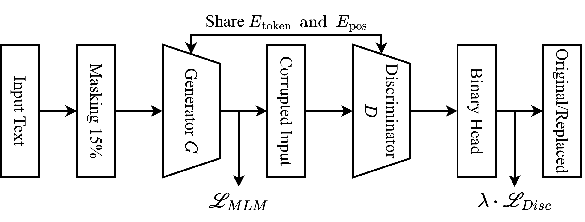
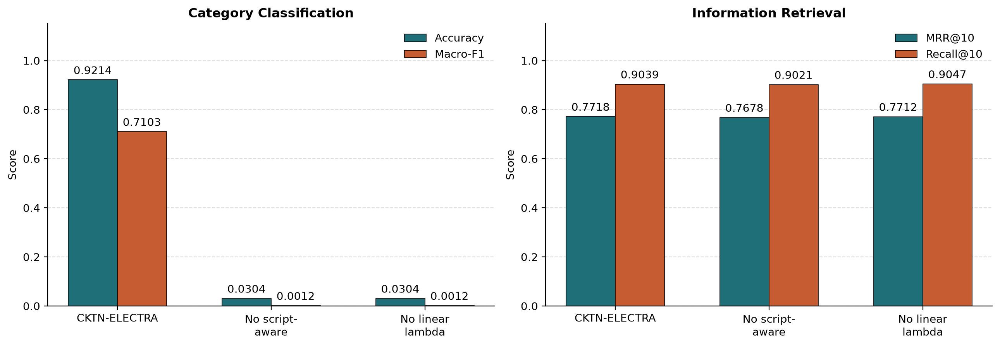

<div align="center">

# Echoes Across Vietnam's Highlands, Delta, and Coast: A Multilingual Corpus for Cham, Khmer, and Tay-Nung

**Anh Trac Duc Dinh**<sup>1,2,†</sup> &nbsp; **Khang Nhat Hoang Vo**<sup>3,4,†,\*</sup> &nbsp; **Vinh Cong Doan**<sup>2</sup> &nbsp; **Tai Tien Ta**<sup>2</sup> &nbsp; **Khoa Duc Anh Lam**<sup>2</sup>

<sup>1</sup>Center for AI Research, VinUniversity, Hanoi, Vietnam<br>
<sup>2</sup>Faculty of Computer Science and Engineering, Ho Chi Minh City University of Technology (HCMUT), VNU-HCM, Vietnam<br>
<sup>3</sup>Mohamed bin Zayed University of Artificial Intelligence, Abu Dhabi, UAE &nbsp; <sup>4</sup>National University of Singapore, Singapore

<sup>†</sup>Equal contribution and project leaders; names are ordered alphabetically &nbsp; <sup>\*</sup>Work done while visiting the National University of Singapore

Correspondence: [anh.dtd@vinuni.edu.vn](mailto:anh.dtd@vinuni.edu.vn), [Khang.Vo@mbzuai.ac.ae](mailto:Khang.Vo@mbzuai.ac.ae)

[📄 Paper](https://arxiv.org/abs/2607.08362) · [🤗 CKTN-ELECTRA](https://huggingface.co/nhatkhangdtp/CKTN-ELECTRA) · [🤗 Vocabulary-augmented RemBERT](https://huggingface.co/ducanhdinh/CKTN-ELECTRA)

</div>

---

## Overview

Vietnam's ethnic minority languages are almost absent from NLP. For **Cham**, **Khmer** and **Tay-Nung** the difficulty goes beyond data scarcity: the three languages differ sharply in script, in contact with Vietnamese, and in how standardised their writing is.

- **Cham** (Austronesian, south-central coast) is traditionally written in a Brahmic-derived abugida but usually appears online in Latin script.
- **Khmer** (Austroasiatic, Mekong Delta) uses a script with no explicit word boundaries.
- **Tay-Nung** (Tai-Kadai, northern highlands) uses Latin-based orthography but has little standardised digital text.

Under these conditions, standard multilingual adaptation can learn the wrong signals.

This repository releases:

1. **CKTN**, the first corpus and benchmark for these languages. It has 44,367 documents and 24M subword tokens, and supports continued pre-training, 28-way category classification and summary-to-document retrieval.
2. **CKTN-ELECTRA**, an encoder adapted with a script-aware recipe: vocabulary augmentation combined with *calibrated* replaced-token pre-training.

Our findings:

- Existing multilingual encoders fragment these languages severely.
- Common adaptation metrics can mislead. A model can lower its language-modelling loss, or excel at lexical-overlap retrieval, while still failing at semantic generalisation across documents.
- A weak, from-scratch ELECTRA generator trained across scripts produces replacements that are trivially detectable, such as a Khmer-script piece inside a Latin-script Cham sentence. The discriminator can then solve replaced-token detection through shortcuts.
- CKTN-ELECTRA blocks these shortcuts. It has substantially less fragmentation and the strongest classification performance of all evaluated models.

<p align="center">
  
</p>
<p align="center"><em>CKTN-ELECTRA. A small generator G fills 15% masked positions. A difficulty-calibrated sampler turns its predictions into replacements. The discriminator D labels every token as original or replaced. G and D share token and position embeddings and are trained with L = L<sub>MLM</sub> + λ(t)·L<sub>Disc</sub>.</em></p>

## Models

| Model | Hub ID | Description |
|---|---|---|
| **CKTN-ELECTRA** | [`nhatkhangdtp/CKTN-ELECTRA`](https://huggingface.co/nhatkhangdtp/CKTN-ELECTRA) | Full model: vocabulary augmentation, script-aware calibrated sampler, linear λ schedule |
| No script-aware | [`nhatkhangdtp/CKTN-ELECTRA-no-script-aware`](https://huggingface.co/nhatkhangdtp/CKTN-ELECTRA-no-script-aware) | Ablation: script-compatibility filter disabled |
| No linear λ | [`nhatkhangdtp/CKTN-ELECTRA-no-linear-lambda`](https://huggingface.co/nhatkhangdtp/CKTN-ELECTRA-no-linear-lambda) | Ablation: λ = λ<sub>max</sub> from the first update |
| No vocabulary augmentation | [`nhatkhangdtp/CKTN-ELECTRA-no-vocab-aug`](https://huggingface.co/nhatkhangdtp/CKTN-ELECTRA-no-vocab-aug) | Ablation: starts from the original `google/rembert` |
| Initialisation | [`ducanhdinh/CKTN-ELECTRA`](https://huggingface.co/ducanhdinh/CKTN-ELECTRA) | Vocabulary-augmented RemBERT before continued pre-training |

All models are RemBERT encoders: 32 layers, hidden size 1152, 18 heads and 256-dimensional input embeddings. CKTN-ELECTRA uses the augmented vocabulary of 254,513 pieces (RemBERT's 250,300 plus 4,213 CKTN pieces).

The released checkpoints are the **discriminators** after continued pre-training, selected by development replaced-token-detection F1. They have no task head; the generator is discarded.

### Quick start

```python
from transformers import AutoModel, AutoTokenizer

tokenizer = AutoTokenizer.from_pretrained("nhatkhangdtp/CKTN-ELECTRA", use_fast=False)
model = AutoModel.from_pretrained("nhatkhangdtp/CKTN-ELECTRA")

inputs = tokenizer("Noọng pỉ hẩu chương trình dân tộc", return_tensors="pt", truncation=True, max_length=512)
hidden = model(**inputs).last_hidden_state   # (1, seq_len, 1152)
```

## Method

### Vocabulary augmentation

Multilingual tokenizers allocate little capacity to Cham, Khmer and Tay-Nung and split their words into long runs of continuation pieces. We therefore extend the source vocabulary $V_{\text{src}}$ before continued pre-training, in three steps.

1. **Candidate selection.** We train an auxiliary SentencePiece Unigram tokenizer on the CKTN pre-training corpus. A piece is kept if it:
   - is new;
   - occurs at least $\tau$ times;
   - passes a validity filter that removes punctuation-contaminated, control, digit-dominant and script-inconsistent pieces.
2. **Score calibration.** Each new piece $t$ gets the mean Unigram log-score of its decomposition $I(t)$ under the original tokenizer, minus a length penalty:

$$\hat\ell(t) = \frac{1}{|I(t)|}\sum_{i\in I(t)} \ell_{\text{src}}(i) - \lambda_{\text{len}}\big(|\tilde t| - 1\big), \qquad V_{\text{ext}} = V_{\text{src}} \cup T$$

3. **Embedding initialisation.** Each new embedding is the mean of its subword decomposition $I(t)$. If that is empty, it is the mean of its character-level decomposition $J(t)$; failing that, it is the mean source embedding $\bar e$.

### Script-aware calibrated replacement pre-training

The discriminator is initialised from the vocabulary-augmented RemBERT. It is paired with a generator about one quarter of its depth (8 layers), trained from scratch. The two share the token, position and segment embeddings.

**Generator.** Standard MLM on the masked view $x^m$:

$$\mathcal{L}_{\text{MLM}}(x;\theta_G) = \mathbb{E}\Big[\sum_{i\in m} -\log p_G(\hat x_i \mid x^m)\Big]$$

**Difficulty-calibrated sampling.** For each masked position, candidates come from the generator's top-$k$ logits. A candidate must satisfy four constraints:

1. it differs from the original token;
2. it is well formed: no special or control tokens, and no punctuation-, digit- or symbol-dominant pieces unless the original is of the same class;
3. it is script compatible: Khmer-script candidates are excluded from Latin Cham/Tay-Nung contexts and vice versa, while script-neutral symbols are allowed;
4. it lies in an embedding-similarity band:

$$\rho_{\min} \le \cos(e_{\hat x_i}, e_c) \le \rho_{\max}$$

The replacement is drawn from a temperature-scaled softmax over the surviving candidates. If none survive, the token is left unchanged. Labels are relative to the original token, so a sample equal to it counts as *original*.

**Discriminator.** Binary cross-entropy over every non-padding position of the corrupted sequence $x^c$, with $y_t = \mathbb{1}[x^c_t = \hat x_t]$:

$$\mathcal{L}_{\text{RTD}}(x;\theta_D) = -\mathbb{E}\Big[\sum_{t=1}^{n} y_t \log D(x^c,t) + (1-y_t)\log\big(1-D(x^c,t)\big)\Big]$$

**Linear generator–discriminator schedule.**
$\mathcal{L} = \mathcal{L}_{\text{MLM}} + \lambda(t)\,\mathcal{L}_{\text{RTD}}$. λ = 0 for epochs 1–2, while only the generator trains. It rises linearly to λ<sub>max</sub> = 50 during epoch 3 and stays fixed for epochs 4–6.

## Experimental Setup

### The CKTN corpus

The corpus was collected around February 2026 from Voice of Vietnam (VOV) and regional news outlets: Ca Mau Newspaper, Can Tho Newspaper, the An Giang Province Web Portal, and Ethnic Minority and Mountainous Regions. Processing covered crawling, boilerplate removal, Unicode normalisation and metadata extraction.

| | Cham | Khmer | Tay-Nung | Total |
|---|---:|---:|---:|---:|
| Documents | 11,481 | 27,808 | 5,078 | 44,367 |
| Sentences | 301,317 | 294,077 | 68,487 | 663,881 |
| Subword tokens (BPE) | 11.36M | 10.17M | 2.50M | 24.03M |
| Pre-training train / dev (docs) | 9,184 / 2,297 | 22,246 / 5,562 | 4,062 / 1,016 | 35,492 / 8,875 |
| Classification classes | 9 | 10 | 9 | 28 |
| Classification train / dev / test | 7,722 / 1,408 / 2,288 | 13,550 / 2,351 / 3,975 | 3,184 / 556 / 934 | 24,456 / 4,315 / 7,197 |
| Retrieval summary–document pairs | 6,545 | 250 | 5,016 | 11,811 |

The three tasks depend on lexical overlap to different degrees:

- **Pre-training** measures token-level adaptation.
- **Retrieval** pairs each summary with its own article, so it rewards shared surface forms.
- **Classification** requires generalising across lexically dissimilar articles.

### Baselines and evaluation

We compare mBERT, XLM-R-base and RemBERT before and after MLM continued pre-training on CKTN.

- **Intrinsic tokenisation:** fertility, token coverage and continuation-token ratio.
- **Category classification:** accuracy and macro-F1. Macro-F1 is the primary metric because the labels are imbalanced.
- **Information retrieval:** MRR@10 and Recall@10 with a bi-encoder.

### Hyperparameters

| | Continued pre-training | Category classification | Retrieval |
|---|---|---|---|
| Epochs | 6 | 5 | 5 |
| Max length | 512 | 512 | 512 |
| Optimiser | AdamW, wd 0.01 | AdamW, wd 0.01 | AdamW, wd 0.01 |
| Learning rate | 2e-5, warmup 6%, linear decay | 1e-4, warmup 6% | 2e-5, warmup 6% |
| Batch size | 8 | 32 | 16 |
| Other | 15% masking, grad clip 1.0, top-k = 64, τ = 1.25, [ρ<sub>min</sub>, ρ<sub>max</sub>] = [0.15, 0.95], λ<sub>max</sub> = 50 | CLS or masked-mean pooling, class-weighted CE | mean pooling, ℓ2-normalised, in-batch contrastive loss with temperature 0.1, source-grouped batches |

All experiments ran on a single 40 GB NVIDIA A100. The full settings are in [`configs/pretrain/`](configs/pretrain).

## Results

### Intrinsic evaluation: tokenisation

| Language | Metric | CKTN-ELECTRA | RemBERT | XLM-R | mBERT |
|---|---|---:|---:|---:|---:|
| Cham | Fertility ↓ | **1.1824** | 1.5862 | 1.6191 | 1.7576 |
| | Token coverage (%) ↑ | **7.3823** | 6.8113 | 5.2734 | 6.3746 |
| | Continuation-token ratio (%) ↓ | **4.8212** | 36.7765 | 22.6879 | 35.1436 |
| Khmer | Fertility ↓ | **1.1721** | 1.6492 | 1.8365 | 1.5037 |
| | Token coverage (%) ↑ | 11.7842 | 8.0324 | 6.9156 | **32.0145** |
| | Continuation-token ratio (%) ↓ | **10.2238** | 39.6847 | 34.5824 | 26.6436 |
| Tay-Nung | Fertility ↓ | **1.2414** | 1.8021 | 1.9186 | 1.9456 |
| | Token coverage (%) ↑ | **12.2723** | 10.7423 | 9.8449 | 9.7154 |
| | Continuation-token ratio (%) ↓ | **5.6142** | 44.5425 | 11.0311 | 41.2632 |

Vocabulary augmentation lowers fertility by 25–32% relative to the strongest baseline. It also cuts the continuation-token ratio from as high as 44.5% to under 11%.

mBERT's higher Khmer coverage is likely an artefact of character-level fallback: its fertility and continuation-token ratio are both worse.

### MLM perplexity on the CKTN development set

| Condition | Metric | RemBERT | XLM-R | mBERT |
|---|---|---:|---:|---:|
| Before CPT | Perplexity ↓ | 346,594.96 | 10.66 | 27.45 |
| | MLM loss ↓ | 12.7559 | 2.3667 | 3.3124 |
| After CPT | Perplexity ↓ | 4.68 | 2.44 | **2.34** |
| | MLM loss ↓ | 1.5367 | 0.8922 | **0.8505** |

CKTN-ELECTRA is excluded because it is trained with replaced-token detection, not MLM. Continued pre-training lowers MLM loss for every baseline, but low MLM loss alone does not predict transferable document representations.

### Main results: downstream tasks

| Task | Condition | Metric | CKTN-ELECTRA | RemBERT | XLM-R | mBERT |
|---|---|---|---:|---:|---:|---:|
| Category classification | Before CPT | Accuracy ↑ | 0.0176 | 0.0176 | 0.7756 | 0.7410 |
| | | Macro-F1 ↑ | 0.0007 | 0.0007 | 0.3217 | 0.4615 |
| | After CPT | Accuracy ↑ | **0.9214** | 0.1454 | 0.8169 | 0.8024 |
| | | Macro-F1 ↑ | **0.7103** | 0.0053 | 0.5617 | 0.5054 |
| Information retrieval | Before CPT | MRR@10 ↑ | 0.7660 | 0.7727 | 0.7266 | 0.3628 |
| | | Recall@10 ↑ | 0.9013 | 0.9017 | 0.8712 | 0.4421 |
| | After CPT | MRR@10 ↑ | 0.7718 | **0.7787** | 0.7361 | 0.3794 |
| | | Recall@10 ↑ | 0.9039 | **0.9049** | 0.8789 | 0.4504 |

- **Classification.** CKTN-ELECTRA is clearly the strongest model after continued pre-training, and its macro-F1 gain indicates transfer to minority classes. RemBERT collapses even though its perplexity drops sharply, which shows a disconnect between intrinsic and extrinsic adaptation.
- **Retrieval.** RemBERT stays strongest, and CKTN-ELECTRA improves only modestly: the opposite of the classification trend. Retrieval is sensitive to lexical overlap between a summary and its source article.
- **Same backbone.** CKTN-ELECTRA's discriminator shares RemBERT's architecture. Its gains therefore come from the cleaner vocabulary and the calibrated RTD objective.

### Ablation study

<p align="center">
  
</p>

| Setting | Accuracy | Macro-F1 | MRR@10 | Recall@10 |
|---|---:|---:|---:|---:|
| **CKTN-ELECTRA** | **0.9214** | **0.7103** | 0.7718 | 0.9039 |
| No script-aware filtering | 0.0304 | 0.0012 | 0.7678 | 0.9021 |
| No linear λ schedule | 0.0304 | 0.0012 | 0.7712 | 0.9047 |

Removing either component drops classification to near-random levels. Retrieval is largely unaffected in both ablations (MRR@10 0.7678–0.7718), so classification, not lexical-overlap retrieval, is the metric that is sensitive to these components.

<details>
<summary><b>Effect of vocabulary augmentation on RemBERT</b></summary>

<br>

Continued pre-training with and without the extended tokenizer, under the same optimisation budget and fine-tuning protocol.

| Metric | No vocab. aug. | Vocab. aug. |
|---|---:|---:|
| Classification accuracy ↑ | 0.0304 | 0.1454 |
| Classification macro-F1 ↑ | 0.0012 | 0.0053 |
| Retrieval MRR@10 ↑ | 0.7857 | 0.7787 |
| Retrieval Recall@10 ↑ | 0.9090 | 0.9049 |

Vocabulary augmentation helps classification, but on its own it is *necessary but far from sufficient*. Retrieval is essentially insensitive to vocabulary quality: matching a summary to its own article needs only the *same* fragments on both sides.

</details>

## Reproducing the results

### Repository layout

```
├── src/cktn_electra/        Python package
│   ├── config.py            pre-training configuration (dataclasses)
│   ├── text.py              script classes and noise detection for token surfaces
│   ├── modeling.py          shared embeddings, generator, calibrated sampler, discriminator
│   ├── schedule.py          linear / constant λ schedules
│   ├── data.py              corpus loading, chunk cache, MLM masking
│   ├── pretrain.py          continued pre-training loop and RTD evaluation
│   ├── checkpoints.py       checkpoint I/O, conversion to Hugging Face RemBertModel
│   ├── hub.py               export, verification and upload to the Hub
│   ├── mlm_baseline.py      MLM continued pre-training of the baselines
│   └── downstream/          encoders, category classification, retrieval
├── scripts/                 command-line entry points (one per step below)
├── configs/pretrain/        main.json and one file per ablation
├── configs/release.json     models published to the Hub
├── release/model_cards/     Hugging Face model cards
├── assets/                  figures
└── tests/                   unit tests (offline, CPU)
```

### Setup

```bash
python -m venv .venv && source .venv/bin/activate
pip install -r requirements.txt      # pinned versions used in the paper
pip install -e .                     # installs the cktn_electra package (Python >= 3.10)
pytest                               # optional: run the unit tests
```

Download the corpus into `corpus/`:

```bash
pip install gdown
gdown --folder https://drive.google.com/drive/folders/1x9bP8J1vf3GdSyjZzaDpvH39YM3tI0qn -O corpus
```

```
corpus/
├── train/  cham_train.json  khmer_train.json  tay_nung_train.json
└── dev/    cham_dev.json    khmer_dev.json    tay_nung_dev.json
```

Each file is a JSON list of records with the fields `site, category, url, title, summary, tags, content`.

### Steps

```bash
# 1. Tokenise and cache the pre-training chunks (once per base tokenizer)
python scripts/prepare_cache.py --config configs/pretrain/main.json

# 2. Continued pre-training of CKTN-ELECTRA (outputs to runs/pretrain/main)
python scripts/pretrain.py --config configs/pretrain/main.json --batch_size 8
#    ablations
python scripts/pretrain.py --config configs/pretrain/no_script_aware.json
python scripts/pretrain.py --config configs/pretrain/no_linear_lambda.json
python scripts/pretrain.py --config configs/pretrain/no_vocab_aug.json
#    resume an interrupted run
python scripts/pretrain.py --config configs/pretrain/main.json --resume latest

# 3. MLM continued pre-training of the baselines (MLM-perplexity table)
python scripts/pretrain_mlm_baseline.py --model_key rembert --epochs 6 --lr 2e-5
python scripts/pretrain_mlm_baseline.py --model_key rembert --eval_only   # before CPT

# 4. Downstream fine-tuning
#    from the released model ...
python scripts/finetune_classification.py --model_key cktn
python scripts/finetune_retrieval.py      --model_key cktn
#    ... or from a local pre-training checkpoint
python scripts/finetune_classification.py --model_key cktn_init \
    --checkpoint runs/pretrain/main/checkpoint/discriminator/discriminator_best.pt
#    baselines
for model in mbert xlmr rembert; do
  python scripts/finetune_classification.py --model_key $model --pooling cls
  python scripts/finetune_retrieval.py      --model_key $model
done

# 5. Analysis
python scripts/eval_rtd_by_language.py --run main=runs/pretrain/main --checkpoint best
python scripts/eval_downstream_by_language.py --task classification \
    --checkpoint runs/downstream/classification/cls/cktn/best.pt
python scripts/eval_generator_ppl.py --run_dir runs/pretrain/main

# 6. Export, verify and publish the discriminators listed in configs/release.json
python scripts/publish_models.py            # export + verify only
python scripts/publish_models.py --push     # requires HF_TOKEN in the environment or .env
```

`--model_key` accepts:

- `cktn`: the released CKTN-ELECTRA;
- `cktn_init`: the vocabulary-augmented RemBERT before pre-training;
- `mbert`, `xlmr`, `rembert`.

The publishing step checks every exported model against its training checkpoint before uploading. All weight tensors must be bitwise identical, and forward outputs must match up to floating-point noise.

## Limitations

- **Register and domain.** CKTN comes entirely from government and state-affiliated outlets. It skews toward formal news register and away from informal or code-switched text.
- **Labels and balance.** The category distribution is heavily imbalanced toward news. Labels are inherited from the source websites and were not independently verified.
- **Size.** The corpus is small (24M tokens) and Tay-Nung is especially scarce. The Khmer retrieval subset (250 pairs) is too small for statistically reliable conclusions.
- **Explanations.** Our accounts of RemBERT's collapse, and of why script-aware filtering and linear scheduling matter, are hypotheses consistent with the observed patterns. They were not confirmed by direct mechanistic probes.
- **Scope.** We evaluate encoder-only backbones only, not decoder-based or instruction-tuned multilingual LLMs. The retrieval task pairs summaries with their own articles, so it is not a general-purpose semantic search benchmark.
- **Preprocessing.** The released scripts do not apply an external Khmer word segmenter; Khmer text is tokenised directly by the SentencePiece tokenizer.

## License

- **Code:** Apache-2.0 (see [LICENSE](LICENSE)).
- **Model weights:** Apache-2.0, inherited from [RemBERT](https://huggingface.co/google/rembert).
- **Corpus:** the CKTN corpus is distributed separately (see *Setup*). The source articles remain subject to the terms of their original publishers.

## Citation

If you use CKTN or CKTN-ELECTRA, please cite:

```bibtex
@misc{dinh2026echoes,
  title         = {Echoes Across Vietnam's Highlands, Delta, and Coast: A Multilingual Corpus for Cham, Khmer, and Tay-Nung},
  author        = {Dinh, Anh Trac Duc and Vo, Khang Nhat Hoang and Doan, Vinh Cong and Ta, Tai Tien and Lam, Khoa Duc Anh},
  year          = {2026},
  eprint        = {2607.08362},
  archivePrefix = {arXiv},
  primaryClass  = {cs.CL},
  url           = {https://arxiv.org/abs/2607.08362}
}
```

## Acknowledgements

CKTN-ELECTRA builds on [RemBERT](https://huggingface.co/google/rembert) and the [ELECTRA](https://arxiv.org/abs/2003.10555) pre-training framework. We thank Voice of Vietnam, Ca Mau Newspaper, Can Tho Newspaper, the An Giang Province Web Portal, and Ethnic Minority and Mountainous Regions, whose public reporting in Cham, Khmer and Tay-Nung made this corpus possible.
